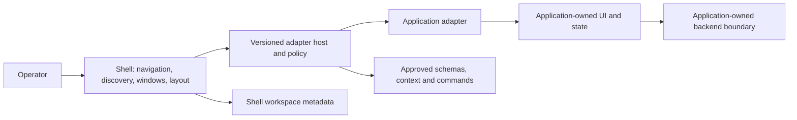

# SCOPE Application Integration Architecture

## Product maturity

| Category | Evidence and scope |
| --- | --- |
| Implemented prototype capabilities | The [Design Studio and standalone operator mockup](SCOPE-Design-Studio-Architecture.html) demonstrate four navigation concepts, classic and managed application arrangements, local simulations, design configuration and exports. Phases B, C and D cover host-aware sizing, optional Context and preview fidelity. The separate synthetic adapter lab exercises a trusted reference host and lifecycle contract. |
| Proposed production architecture | Independent application ownership and release lifecycles, approved adapter/transport contracts, operational deployment and isolation, and optional theme delivery are design proposals. React, Next.js, Qt/QML and other stacks are technology candidates. Runtime, deployment, security and application interface decisions require owner review. |
| Implemented production capabilities | The repository establishes no operational SCOPE shell deployment or verified onboarding of BLOS, Display, Sensor Calibration or Native LOS. |

See the [contract](SCOPE-Application-Integration-Contract.md), [plan](SCOPE-Application-Integration-Plan.md), [onboarding checklist](SCOPE-Application-Onboarding-Checklist.md), and [change-control record](SCOPE-Application-Integration-Change-Control.md).

## Repository assessment: confirmed facts

| Area | Evidence | Integration implication |
| --- | --- | --- |
| Stack | Plain HTML/CSS/JavaScript in `design-studio/` and `mockups/`; dependency-free Node validators/build script | No framework migration or runtime package is necessary for this reference. Node is a developer/build-time tool. |
| Studio state | `design-studio/design-core.js`: `DesignStore`, validation and CSS compiler | Undo/redo is bounded design history; Candidate A/B/C and Baseline are session checkpoints. It is not an application store. |
| Shell mounting | `mockups/scope-integrated-electric-glass.html`: `surface(index, context, explicitSlot)`, `DemoApplicationRegistry`, `demoView`, `refreshDemoHosts` | Existing mocks render into `[data-demo-host]`; registry order and numeric indexes are prototype assumptions. |
| Application state | Same engine file: `demoViews` and separate simulated domain stores | Different slots may share a mock store but keep independent view state. The production shell must not inherit direct store access. |
| Workspace | `design-studio/workspace.js` and `workspace-windows-runtime.js` | The prototype uses host-aware bounding, intended restore rectangles and one cached managed DOM view per application. The pure model currently knows the four simulated application IDs. |
| Navigation | Aperture, Mosaic, Portal and Command Deck are navigation concepts. Single/split/stacked and Managed Windows are application arrangements | Preserve navigation. Future adapters should attach below the shell's application host boundary. |
| Ownership | Application forms, application action dialog and domain operations live in the mock engine | The mock engine shares visual roles across shell and simulated controls. Production applications own any adoption of approved presentation tokens. |
| Preview protocol | `preview-bridge.js` checks parent source, origin, version, channel and message type | This is a Studio-to-engine prototype protocol, not a general application bus. Do not reuse it as an authorization mechanism. |
| Detached windows | `embedded-windows.js`, `operator-runtime.js` | Pop-outs run independent simulations; only compatible view settings return. No operational model synchronization is implemented. |
| Offline distribution | `scripts/build-standalone.cjs`, `offline.js`, `exports.js`, `dist/SCOPE-Design-Studio.html` | The current Studio has embedded resources and can run without a web server. New integration modules are not added to that bundle. |
| Baseline | Phase 1 `791e4bf`; Phase 2 reverted by `2730fdf`; Phase 3 `30bf8d6` | All 31 restored presets, Component Editor, windows, exports and application mockups are protected. Earlier material groups remain; rejected Phase 2 is not restored. |

## Proposed production ownership and boundaries

This diagram shows the proposed operational responsibility boundaries. The isolated reference exercises a subset with a synthetic application.

The shell owns application discovery and approved registration, navigation, window geometry/focus, lifecycle coordination, shell styling, workspace metadata and explicitly permitted communication. The application owns its UI tree, validation, domain logic, algorithms, data stores, backend communication, authorization decisions and optional view snapshots. An adapter translates lifecycle and approved messages; it does not expose application internals to the shell.

The future shell should allocate one exclusive mount container per approved instance and invoke the adapter. It must not query application fields, alter forms, read globals, call mock module methods or interpret domain stores. Application status reports are claims for display, not authority to grant access. Application backends must enforce their own permissions.

The Studio retains its prototype registry, rendering, slot maps and cached DOM. If the reference is later connected to the Studio for engineering evaluation, the design would need a reviewed mount and lifecycle seam. Production can implement the agreed contracts in its chosen runtime without using the Studio code.

## Integration options and conditional recommendation

| Option | Isolation and trust | Independence and state | Performance/maintenance | Decision |
| --- | --- | --- | --- | --- |
| In-process web module/component | Shared JavaScript realm and DOM authority; use only reviewed, trusted code | Lifecycle contract can preserve a stable mount; release/runtime compatibility must be coordinated | Least reference overhead, but coupling and cleanup require discipline | **Implemented reference module host only.** Web components are an optional packaging choice, not implemented here. |
| Isolated iframe | Separate DOM boundary; permissions, exact origins, CSP, sandbox policy and validated messages must be designed together | Can support separately deployed web UIs; frame reload and pop-out state need explicit policy | Adds asynchronous messaging, failure and accessibility considerations | **Proposed candidate if production is web-based and app origins/embedding constraints permit it.** Only a pure message guard is implemented. |
| Service/API boundary | Keeps backend ownership; requires authenticated, authorized, validated requests | Supports independent services and data contracts | Requires API/version/error coordination; does not itself mount an existing UI | **Complementary boundary**, not a replacement for a UI adapter. No service client is implemented. |
| Native host/plugin/IPC | Depends on the actual host/process/privilege model | May be required for native UIs or deployment constraints | Packaging, process lifecycle, signing and IPC are runtime-specific | **Deferred** until actual native/runtime requirements are supplied. No native bridge is implemented. |

Repository evidence supports a small browser/module **reference** because the current artifacts are local web simulations. It does not establish the production runtime, the real applications' frameworks, iframe eligibility or security model. Do not select a final production topology from this prototype alone. Prefer isolation for separately owned or less-trusted code when the approved runtime supports it; require application and security-team review before choosing a transport.

## Implemented reference

`src/integration/` is independent of the Studio. It supplies a manifest validator/schema, lifecycle host, bounded payload validation, application-scoped event/command permissions, optional state and context, cooperative deadlines, cleanup and a pure future-frame guard. Factories are registered explicitly by trusted host code. Manifests cannot supply executable URLs or trigger arbitrary loading.

`examples/app-integration/index.html` is a separate offline engineering lab. A synthetic counter application demonstrates registration, launch into a bounded managed window, activation/deactivation, resize notifications, validated context/commands/events, a recoverable error, optional view save/restore and disposal. It reuses the pure workspace geometry model without depending on the live Studio DOM, host measurement or application registry. The `blos` model key selects an existing sizing profile only; no BLOS UI or store is loaded. The JSON manifest and inline local-script copy are tested for equality so direct file launch needs no fetch.

Reference close explicitly disposes the adapter; reference minimize deactivates it. Existing Phase 3 close caches an application DOM view. Production hide-versus-unload policy must be approved separately; this reference does not change current Studio close semantics.

## Security and reliability decisions

| Implemented here | Production work still required |
| --- | --- |
| Explicit factory registration, singleton identity and contract version 1 | Trusted distribution, signing, allowlisting and actual code-origin enforcement |
| Host-granted capabilities and approved payload schemas | Authenticated identity and policy decisions; application/backend authorization |
| Bounded plain JSON, safe key checks and copied event payloads | Per-topic operational schemas, privacy classification, rate/volume limits and auditing |
| Pinned source/origin/session/identity/version/sequence guard for future frames | Full iframe transport, handshake, routing, correlation, timeouts, CSP/sandbox and deployment-origin review |
| Serialized calls, cooperative deadline cancellation and quarantine after uncertain cleanup | Process/frame termination, startup health probes and recovery for unresponsive or hostile code |
| Disposal and registered cleanup callbacks; bounded synthetic diagnostics | Durable operational observability, log retention/redaction and support workflows |
| Versioned optional application view snapshots | Approved state migration, durable workspace policy and sensitive-data storage decisions |

The module reference executes trusted code in the same realm. The API surface and capabilities are contracts, **not a sandbox**: same-realm code can access browser globals. A timeout cannot interrupt a blocked JavaScript thread or undo late side effects. The host aborts the context, suppresses subsequent emit/report callbacks, attempts disposal and quarantines the session if a deadline or cleanup fails. Recovery then requires replacing that isolated host/session; production may need process/frame replacement. Do not add an unrestricted global event bus or forward commands automatically between applications.

## Unresolved decisions and owners

| Question | Required owner/input |
| --- | --- |
| Is production a browser, desktop wrapper, native host or mixed environment? | Platform/deployment owner |
| What frameworks, embedding APIs, lifecycles and resize behavior do the four real UIs support? | BLOS, Display, Sensor Calibration and Native LOS teams, individually |
| What origins, authentication flows, cookies, frame restrictions and network boundaries apply? | Security/identity/platform plus each application team |
| Are multiple instances safe; what does close mean; which view state may leave the app? | Application owner and operator workflow owner |
| Which contexts/commands are allowed, who authorizes them, and what is the source of truth? | Domain/API owners and security |
| What availability, startup latency, resource, display, offline and accessibility requirements apply? | Operations/product/platform |
| Which version compatibility and rollback guarantees are required? | Release/platform and application owners |

No real application readiness, production authorization or end-to-end operational correctness is claimed. The next step is owner review of these decisions and contracts, followed by one explicitly approved onboarding target under the staged [plan](SCOPE-Application-Integration-Plan.md).

## Optional common design system and theme ownership

The SCOPE application design system is a portable vocabulary of **presentation suggestions**, derived from the existing Phase 1 tokens. It is not a new theme catalog, a global application stylesheet or a requirement to adopt the shell's appearance. All restored presets remain unchanged. Level 0 is the default for existing manifests; no application must change its interface to integrate with SCOPE.

| Compatibility | Application commitment | Shell commitment |
| --- | --- | --- |
| Level 0: independent | Own appearance; no theme receiver | Do not deliver or inject application styling |
| Level 1: basic | Accept mode, primary/neutral colors, family, base size and scale; may declare dynamic updates | Deliver only negotiated basic values; initial-only applications may defer changes until their next normal mount |
| Level 2: supported tokens | Accept the basic set and declare the additional tokens actually implemented; support dynamic updates | Send the supported intersection; report unsupported requested tokens; do not require every control token |

The versioned [theme exchange contract](SCOPE-Application-Integration-Contract.md#optional-theme-exchange-contract-v1) defines exact names, types, ordering, acknowledgements and fallback. A declaration describes support, not permission: future host policy must separately authorize theme delivery. Neither the declaration nor the helper causes styling in the current host.

The application must reserve separate operational tokens for alarms, severity/status colors, target tracks, maps, sensor states, data-series palettes and safety-critical indicators. These are excluded from exchange v1, including the Studio's success/warning/error/neutral component categories. A theme may style a generic button but must not replace an alarm button's semantic fill, its meaning, or accessible label. Application owners choose which controls may inherit; a Level 2 application can keep domain-specific controls wholly independent. Reject an unsafe combination atomically, retain the last accepted presentation and report a bounded reason. Never reinterpret a warning as a decorative accent.

## Theme implementation strategies (proposed production wiring)

| Hosting model | Delivery and application-owned adoption | Boundary, fallback and limitations |
| --- | --- | --- |
| Same DOM | Explicit adapter receiver takes validated data; app maps selected tokens to scoped CSS custom properties on its own root | No shell selector into descendants, global reset, stylesheet injection or inherited global variables as an implicit API. App resets inherited CSS at its boundary where needed. Trusted same-realm code is not sandboxed. |
| Shadow DOM / web component | Public method or property receives the same payload; component maps values inside its shadow root | Shadow DOM still inherits some font/color/custom properties. Reset or explicitly consume them; do not use shell `::part` rules to bypass ownership. |
| iframe | Versioned message payload over a pinned source/origin/session channel; app maps to its own CSS | No `contentDocument` access, including same-origin frames. Require acknowledged handshake, sequence/correlation, bounded schemas and exact `targetOrigin`. Guard exists; transport does not. Opaque file origins need an explicitly reviewed local transport, not a wildcard production exception. |
| Separately hosted web application | Framed deployment follows iframe policy; top-level app uses an authenticated, explicitly paired channel if supported | Hosting alone creates no trust or channel. Account for origin/CSP/auth restrictions, independent reloads and disconnect. Without approved connectivity remain independent; no URL credentials or raw design JSON in query strings. |
| Native application | Typed IPC maps portable colors, font aliases and logical sizes to native resources on the app UI thread | Proposed only if production really includes native UIs. Respect system high contrast, font availability and platform scaling; never automate/recolor native controls externally. Native LOS's name does not establish its runtime. |

Use CSS variables such as an **app-owned** `--reference-button-bg` only as a local implementation mapping, not as the wire format. Native applications need no CSS parser. Apps own responsive layout, contrast verification, keyboard/focus behavior and accessible names. OS forced colors, user text scaling and reduced motion take priority; theme delivery must not remove focus or reduce accessibility preferences.

## Design Studio to application theme projection

Proposed flow: validate `scope-design.json` with `ScopeDesign.validate`, resolve its existing preset and effective Phase 1 component overrides with `ScopeVisuals.tokens` and `resolveShellStyle`, then project only approved presentation values into `scope.theme` v1. Reuse the existing resolvers; do not add a parallel theme engine or reinterpret raw sparse overrides. The projection is a future shell-runtime interface, **not implemented or connected to the Studio by this change**.

| Resolved Phase 1 source | Portable target | Handling |
| --- | --- | --- |
| canvas, panel, raised, inset, text, secondary, border, accent | `color.*` neutral/primary roles | Use resolved values; choose a readable `onPrimary` against the actual accent |
| effective shell typography | `type.*` | Map family to an agreed alias, preserve effective sizes/weight, apply user scale once |
| effective shell buttons/tabs/inputs | matching control groups | Translate hover/pressed/selected/disabled/focus names; no app semantic component groups |
| material and effective spacing/density | `border.*`, `space.*`, `layout.density` | Convert to bounded logical pixels and agreed density vocabulary |
| focus roles and user accessibility preferences | `focus.*`, `accessibility.reducedMotion` | Keep visible focus; OS/user accessibility overrides take precedence |

Application-specific overrides remain application-owned. Shell theme changes and reset-to-theme change only the resolved suggestions, without clearing those application overrides or any application state. Projection must flatten translucent surfaces against their actual background to opaque v1 colors, map only approved font aliases, and diagnose unrepresentable values instead of silently inventing a mapping. Do not transmit executable CSS, fonts/URLs, navigation/window layout, application parameters, snapshots, tokens with operational semantics, or raw Studio configuration. Not every Studio setting is an application theme setting. A successful shell design import is not proof that any application accepted its projection.

## Theme implementation status

Implemented in the isolated reference: optional manifest metadata validation, a typed token catalog, payload validation and pure capability negotiation in `theme-contract.js`, plus executable protocol-policy fixtures. Existing manifests, host grants, synthetic UI and the engineering lab's appearance remain unchanged. The lab loads the local helper but adds no controls. No Studio/runtime/mockup/distribution file changes are necessary.

Still proposed: design projection, host authorization/delivery, application receivers and acknowledgements, transport/session management, live updates, CSS-variable mapping, native mapping and real-application contrast/accessibility acceptance. Conformance fixtures test examples of receiver policy; they are not evidence of an implemented receiver or production integration.
