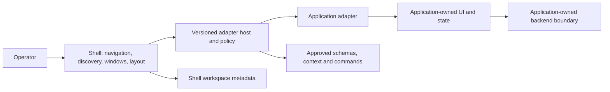

# SCOPE Application Integration Architecture

Status: **provisional architecture plus implemented, isolated reference**. This is not a production integration platform and no real application has been migrated. See the [contract](SCOPE-Application-Integration-Contract.md), [plan](SCOPE-Application-Integration-Plan.md), [onboarding checklist](SCOPE-Application-Onboarding-Checklist.md), and [change-control record](SCOPE-Application-Integration-Change-Control.md).

## Repository assessment: confirmed facts

| Area | Evidence | Integration implication |
| --- | --- | --- |
| Stack | Plain HTML/CSS/JavaScript in `design-studio/` and `mockups/`; dependency-free Node validators/build script | No framework migration or runtime package is necessary for this reference. Node is a developer/build-time tool. |
| Studio state | `design-studio/design-core.js`: `DesignStore`, validation and CSS compiler | Undo/redo is bounded design history; Candidate A/B/C and Baseline are session checkpoints. It is not an application store. |
| Shell mounting | `mockups/scope-integrated-electric-glass.html`: `surface(index, context, explicitSlot)`, `DemoApplicationRegistry`, `demoView`, `refreshDemoHosts` | Existing mocks render into `[data-demo-host]`; registry order and numeric indexes are prototype assumptions. |
| Application state | Same engine file: `demoViews` and separate simulated domain stores | Different slots may share a mock store but keep independent view state. The production shell must not inherit direct store access. |
| Workspace | `design-studio/workspace.js` and `workspace-windows-runtime.js` | Phase 3 provides pure bounded geometry and one cached managed DOM view per application. It currently knows the four application IDs. |
| Navigation | Aperture, Mosaic, Portal and Command Deck, plus classic single/split/stacked layouts | Preserve navigation. Future adapters should attach below the shell's application host boundary. |
| Ownership | Application forms, application action dialog and domain operations live in the mock engine | No existing application code or dialog is changed. Appearance integration already exists through global theme roles; this is not permission to manipulate production internals. |
| Preview protocol | `preview-bridge.js` checks parent source, origin, version, channel and message type | This is a Studio-to-engine prototype protocol, not a general application bus. Do not reuse it as an authorization mechanism. |
| Detached windows | `embedded-windows.js`, `operator-runtime.js` | Pop-outs run independent simulations; only compatible view settings return. No operational model synchronization is implemented. |
| Offline distribution | `scripts/build-standalone.cjs`, `offline.js`, `exports.js`, `dist/SCOPE-Design-Studio.html` | The current Studio has embedded resources and can run without a web server. New integration modules are not added to that bundle. |
| Baseline | Phase 1 `791e4bf`; Phase 2 reverted by `2730fdf`; Phase 3 `30bf8d6` | All 31 restored presets, Component Editor, windows, exports and application mockups are protected. Earlier material groups remain; rejected Phase 2 is not restored. |

## Ownership and boundaries

The shell owns application discovery and approved registration, navigation, window geometry/focus, lifecycle coordination, shell styling, workspace metadata and explicitly permitted communication. The application owns its UI tree, validation, domain logic, algorithms, data stores, backend communication, authorization decisions and optional view snapshots. An adapter translates lifecycle and approved messages; it does not expose application internals to the shell.

The future shell should allocate one exclusive mount container per approved instance and invoke the adapter. It must not query application fields, alter forms, read globals, call mock module methods or interpret domain stores. Application status reports are claims for display, not authority to grant access. Application backends must enforce their own permissions.

The existing Studio is deliberately **not converted** into that host in this change. Its numeric registry, `surface(...)` rendering, slot maps and cached DOM remain intact. A future approved bridge would sit at `workspace-windows-runtime.js:createWindow` and lifecycle notification points, with a compatibility path for existing mocks. That bridge is proposed work; no such live Studio integration is implemented here.

## Integration options and conditional recommendation

| Option | Isolation and trust | Independence and state | Performance/maintenance | Decision |
| --- | --- | --- | --- | --- |
| In-process web module/component | Shared JavaScript realm and DOM authority; use only reviewed, trusted code | Lifecycle contract can preserve a stable mount; release/runtime compatibility must be coordinated | Least reference overhead, but coupling and cleanup require discipline | **Implemented reference module host only.** Web components are an optional packaging choice, not implemented here. |
| Isolated iframe | Separate DOM boundary; permissions, exact origins, CSP, sandbox policy and validated messages must be designed together | Can support separately deployed web UIs; frame reload and pop-out state need explicit policy | Adds asynchronous messaging, failure and accessibility considerations | **Proposed candidate if production is web-based and app origins/embedding constraints permit it.** Only a pure message guard is implemented. |
| Service/API boundary | Keeps backend ownership; requires authenticated, authorized, validated requests | Supports independent services and data contracts | Requires API/version/error coordination; does not itself mount an existing UI | **Complementary boundary**, not a replacement for a UI adapter. No service client is implemented. |
| Native host/plugin/IPC | Depends on the actual host/process/privilege model | May be required for native UIs or deployment constraints | Packaging, process lifecycle, signing and IPC are runtime-specific | **Deferred** until actual native/runtime requirements are supplied. No native bridge is implemented. |

Repository evidence supports a small browser/module **reference** because the current artifacts are local web simulations. It does not establish the production runtime, the real applications' frameworks, iframe eligibility or security model. Do not select a final production topology from this prototype alone. Prefer isolation for separately owned or less-trusted code when the approved runtime supports it; require application and security-team review before choosing a transport.

## Implemented reference

`src/integration/` is independent of the Studio. It supplies a manifest validator/schema, lifecycle host, bounded payload validation, application-scoped event/command permissions, optional state and context, cooperative deadlines, cleanup and a pure future-frame guard. Factories are registered explicitly by trusted host code. Manifests cannot supply executable URLs or trigger arbitrary loading.

`examples/app-integration/index.html` is a separate offline engineering lab. A synthetic counter application demonstrates registration, launch into a bounded managed window, activation/deactivation, resize notifications, validated context/commands/events, a recoverable error, optional view save/restore and disposal. It reuses the Phase 3 geometry **model**, not the live Studio DOM/runtime or any application registry. The `blos` model key selects an existing sizing profile only; no BLOS UI or store is loaded. The JSON manifest and inline local-script copy are tested for equality so direct file launch needs no fetch.

Reference close explicitly disposes the adapter; reference minimize deactivates it. Existing Phase 3 close caches an application DOM view. Production hide-versus-unload policy must be approved separately; this reference does not change current Studio close semantics.

## Security and reliability decisions

| Implemented here | Production work still required |
| --- | --- |
| Explicit factory registration, singleton identity and contract version 1 | Trusted distribution, signing, allowlisting and actual code-origin enforcement |
| Host-granted capabilities and approved payload schemas | Authenticated identity and policy decisions; application/backend authorization |
| Bounded plain JSON, safe key checks and copied event payloads | Per-topic operational schemas, privacy classification, rate/volume limits and auditing |
| Pinned source/origin/session/identity/version/sequence guard for future frames | Full iframe transport, handshake, routing, correlation, timeouts, CSP/sandbox and deployment-origin review |
| Serialized calls, cooperative deadline cancellation and quarantine after uncertain cleanup | Process/frame termination, startup health probes and recovery for unresponsive or hostile code |
| Disposal and registered cleanup callbacks; bounded synthetic diagnostics | Durable operational observability, log retention/redaction and support workflows |
| Versioned optional application view snapshots | Approved state migration, durable workspace policy and sensitive-data storage decisions |

The module reference executes trusted code in the same realm. The API surface and capabilities are contracts, **not a sandbox**: same-realm code can access browser globals. A timeout cannot interrupt a blocked JavaScript thread or undo late side effects. The host aborts the context, suppresses subsequent emit/report callbacks, attempts disposal and quarantines the session if a deadline or cleanup fails. Recovery then requires replacing that isolated host/session; production may need process/frame replacement. Do not add an unrestricted global event bus or forward commands automatically between applications.

## Unresolved decisions and owners

| Question | Required owner/input |
| --- | --- |
| Is production a browser, desktop wrapper, native host or mixed environment? | Platform/deployment owner |
| What frameworks, embedding APIs, lifecycles and resize behavior do the four real UIs support? | BLOS, Display, Sensor Calibration and Native LOS teams, individually |
| What origins, authentication flows, cookies, frame restrictions and network boundaries apply? | Security/identity/platform plus each application team |
| Are multiple instances safe; what does close mean; which view state may leave the app? | Application owner and operator workflow owner |
| Which contexts/commands are allowed, who authorizes them, and what is the source of truth? | Domain/API owners and security |
| What availability, startup latency, resource, display, offline and accessibility requirements apply? | Operations/product/platform |
| Which version compatibility and rollback guarantees are required? | Release/platform and application owners |

No real application readiness, production authorization or end-to-end operational correctness is claimed. The next step is owner review of these decisions and contracts, followed by one explicitly approved onboarding target under the staged [plan](SCOPE-Application-Integration-Plan.md).
