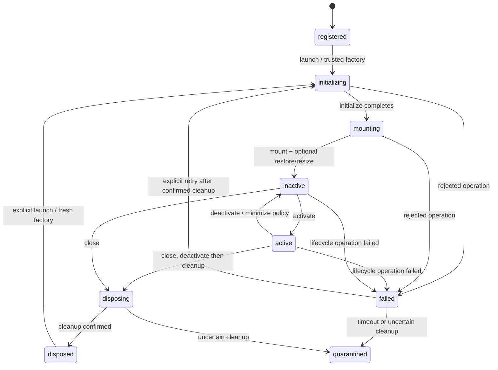

# Application Integration Contract — Reference v1

Status: **implemented for a trusted, in-process synthetic reference**. Iframe/service/native transports and real application adapters remain proposals. The runtime validator in [`contracts.js`](../src/integration/contracts.js) is authoritative for the executable reference. This contract does not change Design Studio schemas or application mockups.

## Registration and manifest

The host receives a manifest, a synchronous trusted factory and a separate host-owned capability grant. Registration validates data and approved schemas without executing the factory. Unknown fields, duplicate IDs and unsupported versions are rejected. No dynamic import URL or application-supplied executable entry is supported.

```js
const host = new ScopeAdapterHost({ schemas: ScopeReferenceApplication.schemas });
host.register(ScopeReferenceApplication.manifest,
  ScopeReferenceApplication.create,
  { grants: ['state', 'commands', 'context'] });
await host.launch('reference.status', shellOwnedContainer,
  { size: { width: 640, height: 480 } });
```

See the [JSON manifest](../src/integration/reference.manifest.json) and [schema](../src/integration/application-manifest.schema.json). All fields are required: `schemaVersion:1`, stable namespaced `id`, human-readable `name`, three-part numeric application `version`, `contractVersion:1`, `integration:'module'`, `singleton:true`, and arrays `capabilities`, `publishes`, `commands`, `contexts`. The arrays can be empty. Published events and commands must start with the application's ID plus a dot. Each event, command and context must also have a host-approved validator. Command request and response validators are both required. Merely declaring a capability never grants it.

The host negotiates exact contract version 1 only. It does not silently downgrade or perform semver range negotiation. Snapshot restore requires the same application version. Future range negotiation or state migration requires a reviewed contract revision and application-owned migration logic.

## Required adapter methods

The factory must synchronously return an object with these methods. Acquire external resources during initialize/mount, after the host can register cleanup, rather than starting work in the factory constructor. Methods may return a value or a promise. The host serializes operations per application and applies its configured deadline (default 1500ms, configurable 1–30000ms).

| Method | Responsibility |
| --- | --- |
| `initialize(context)` | Capture the narrow context, establish app-owned resources and register cleanup. Respect `context.signal`. |
| `mount(container)` | Mount only into the exclusive shell-owned container supplied for this instance. The application owns its descendants. |
| `activate()` | Resume app-owned work appropriate for a visible/active view. Must tolerate the documented lifecycle. |
| `deactivate()` | Pause visibility-dependent work without losing app-owned state. |
| `resize({width,height})` | Respond to non-negative bounded container pixel dimensions. The shell does not resize internal controls itself. |
| `dispose()` | Idempotently release DOM/listeners/timers/resources owned by this instance, including partially initialized mounts. |

`initialize` receives a frozen context containing only `appId`, `contractVersion`, an `AbortSignal`, `emit(topic,payload)`, `report(status)` and `onDispose(cleanup)`. It receives no shell registry, global store, credential, internal application object or DOM outside its mount. Up to 100 cleanup callbacks may be registered; the host runs them once in reverse order. Explicit adapter disposal remains responsible for its own resources. All callback promises are bounded and timers are cleared after completion.

This narrow API does not prevent trusted same-realm code from using globals. It is an ownership contract, not isolation enforcement.

## Optional capabilities

| Grant | Required adapter methods | Host operation and rules |
| --- | --- | --- |
| `state` | `saveState()`, `restoreState(data)` | `save(id)` returns a versioned bounded snapshot; `launch(...,{state})` checks identity/version and calls restore after mount, before activation. Application validates its own data shape. |
| `commands` | `handleCommand(name,payload)` | `command(id,name,payload)` checks the manifest allowlist and validates request and response. No automatic broadcast or direct app-to-app routing. |
| `context` | `receiveContext(name,payload)` | `context(id,name,payload)` accepts only declared, host-approved contexts. Context is advisory, never authorization. |

Capability discovery uses `host.status(id)` or `host.list()`. Operations require a mounted active/inactive instance; unsupported operations reject. The sample disallows incrementing while inactive. A recoverable command or application validation error leaves the mounted lifecycle unchanged and records a sanitized diagnostic. A command deadline triggers cancellation, cleanup and quarantine.

## Lifecycle and recovery



Repeated launch against the same mounted container returns the existing singleton. A different container is rejected; no duplicate mount is created. Activation/deactivation is idempotent at the host boundary. Close first deactivates an active instance, then aborts its context, disposes it and runs cleanup callbacks. Cleanup continues even after one callback fails. Repeated close on a disposed instance is harmless.

On failed initialize/mount/activation/resize, the host attempts cleanup. A confirmed clean synchronous/rejected failure can be retried explicitly with a fresh factory. A timed-out operation or failed cleanup is quarantined. Old contexts cannot emit/report after abortion, including after a new instance is created. The host does not claim to kill blocked same-thread code or guarantee browser-unload cleanup. Production supervision/termination needs a suitable isolation boundary.

The executable reference uses one explicit lifecycle operation at a time per application. It does not yet provide global scheduling across different applications or priority/coalescing for high-rate resize streams. Platform integrations should coalesce resize notifications and define startup/health policies during onboarding.

## Data and communication

Payloads are copied plain JSON only: finite numbers, strings, booleans, null, arrays and plain records. Prototype-sensitive keys, functions, symbols, class instances and cycles are rejected. Limits are 2000 visited values, nesting depth 10, 8192 UTF-16 units per string and 32768 UTF-8 bytes per complete JSON payload. Schema validation is applied before routing and to command results. No `eval`, markup execution or arbitrary remote loading is used.

`context.emit` may publish only manifest-declared, application-namespaced events with approved schemas. The shell explicitly subscribes through `host.subscribe`, which returns an unsubscribe function. Each listener receives a copied payload; listener failure cannot stop delivery to another listener. The shell decides whether and how an event becomes an approved context or command for another application. Operational command authorization remains an application/backend responsibility.

`report({level,code,message})` accepts `healthy`, `degraded` or `error`, a bounded machine code and bounded human-readable text. The host adds receipt time. A report is not a readiness guarantee, an authenticated backend health measurement or an authorization result. No heartbeat monitor is implemented. Diagnostics contain application ID, operation, lifecycle and a fixed error category; they omit raw payloads, credentials, stack traces and application exception messages. The reference lab may display the synthetic command's local error, using `textContent`.

## Optional snapshot

```json
{
  "schemaVersion": 1,
  "contractVersion": 1,
  "appId": "reference.status",
  "applicationVersion": "0.1.0",
  "data": { "count": 1, "selection": "sample-a" }
}
```

A snapshot belongs to its application. The shell checks envelope identity, size and version, but must not interpret domain state. Production storage, retention, encryption, migration and sensitive-data exclusions are not implemented. The lab retains an optional snapshot in memory only. Existing Studio JSON/CSS/HTML exports are untouched.

## Proposed iframe transport and implemented guard

The pure `messageGuard` validates a future receive envelope. It requires a captured source object, exact non-opaque HTTP(S) origin, app ID, approved message schemas and session ID of at least 16 characters. It rejects source/origin mismatches, unknown fields/types/versions, wrong app/session, invalid payloads, non-increasing sequences and replay. Failed payload validation does not advance the accepted sequence.

```json
{
  "namespace": "scope-integration",
  "contractVersion": 1,
  "sessionId": "host-generated-unpredictable-session",
  "appId": "reference.status",
  "sequence": 1,
  "type": "status",
  "payload": { "level": "healthy", "code": "reference.ready", "message": "Synthetic sample" }
}
```

The guard is **not a message listener, iframe adapter, authentication protocol or full transport**. No iframe is mounted by the reference. Production must define unpredictable session generation, handshake, explicit `targetOrigin`, correlation IDs, request/reply errors, channel closure, sandbox/CSP policy, origin changes and authorization. The current Studio's opaque local-file preview channel is a prototype exception and is not imported into this proposed production protocol. Native IPC and service/API contracts remain application/platform-specific proposals.
