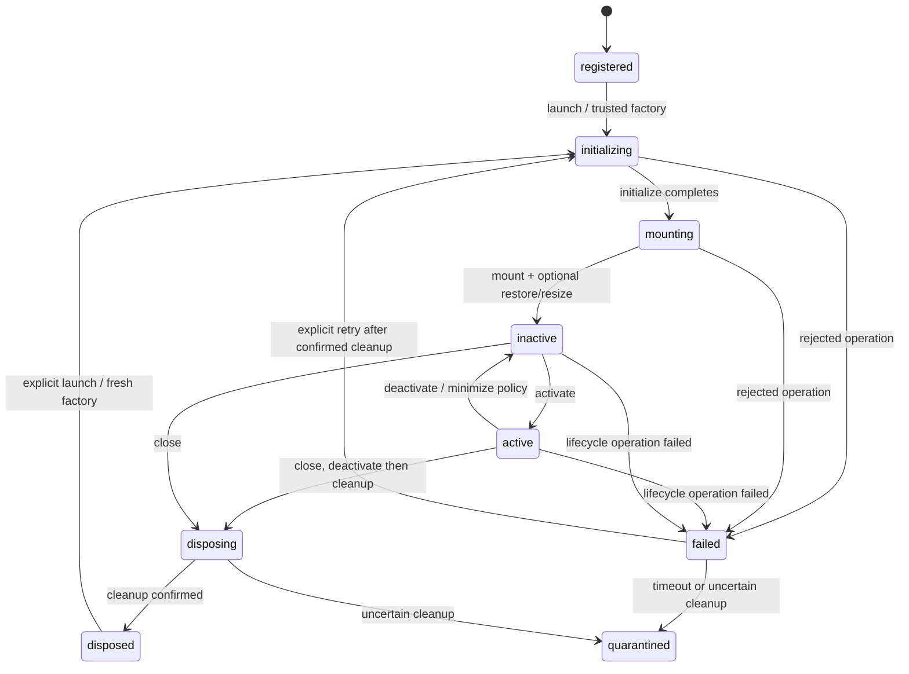

# Application Integration Contract — Reference v1

Status: **implemented for a trusted, in-process synthetic reference**. Iframe/service/native transports and real application adapters remain proposals. The runtime validator in [`contracts.js`](../src/integration/contracts.js) is authoritative for the executable reference. This contract does not change Design Studio schemas or application mockups.

## Registration and manifest

The host receives a manifest, a synchronous trusted factory and a separate host-owned capability grant. Registration validates data and approved schemas without executing the factory. Unknown fields, duplicate IDs and unsupported versions are rejected. No dynamic import URL or application-supplied executable entry is supported.

```js
const host = new ScopeAdapterHost({ schemas: ScopeReferenceApplication.schemas });
host.register(ScopeReferenceApplication.manifest,
  ScopeReferenceApplication.create,
  { grants: ['state', 'commands', 'context'] });
await host.launch('reference.status', shellOwnedContainer,
  { size: { width: 640, height: 480 } });
```

See the [JSON manifest](../src/integration/reference.manifest.json) and [schema](../src/integration/application-manifest.schema.json). The original fields are required (the optional `theme` extension is described below): `schemaVersion:1`, stable namespaced `id`, human-readable `name`, three-part numeric application `version`, `contractVersion:1`, `integration:'module'`, `singleton:true`, and arrays `capabilities`, `publishes`, `commands`, `contexts`. The arrays can be empty. Published events and commands must start with the application's ID plus a dot. Each event, command and context must also have a host-approved validator. Command request and response validators are both required. Merely declaring a capability never grants it.

The host negotiates exact contract version 1 only. It does not silently downgrade or perform semver range negotiation. Snapshot restore requires the same application version. Future range negotiation or state migration requires a reviewed contract revision and application-owned migration logic.

## Required adapter methods

The factory must synchronously return an object with these methods. Acquire external resources during initialize/mount, after the host can register cleanup, rather than starting work in the factory constructor. Methods may return a value or a promise. The host serializes operations per application and applies its configured deadline (default 1500ms, configurable 1–30000ms).

| Method | Responsibility |
| --- | --- |
| `initialize(context)` | Capture the narrow context, establish app-owned resources and register cleanup. Respect `context.signal`. |
| `mount(container)` | Mount only into the exclusive shell-owned container supplied for this instance. The application owns its descendants. |
| `activate()` | Resume app-owned work appropriate for a visible/active view. Must tolerate the documented lifecycle. |
| `deactivate()` | Pause visibility-dependent work without losing app-owned state. |
| `resize({width,height})` | Respond to non-negative bounded container pixel dimensions. The shell does not resize internal controls itself. |
| `dispose()` | Idempotently release DOM/listeners/timers/resources owned by this instance, including partially initialized mounts. |

`initialize` receives a frozen context containing only `appId`, `contractVersion`, an `AbortSignal`, `emit(topic,payload)`, `report(status)` and `onDispose(cleanup)`. It receives no shell registry, global store, credential, internal application object or DOM outside its mount. Up to 100 cleanup callbacks may be registered; the host runs them once in reverse order. Explicit adapter disposal remains responsible for its own resources. All callback promises are bounded and timers are cleared after completion.

This narrow API does not prevent trusted same-realm code from using globals. It is an ownership contract, not isolation enforcement.

## Optional capabilities

| Grant | Required adapter methods | Host operation and rules |
| --- | --- | --- |
| `state` | `saveState()`, `restoreState(data)` | `save(id)` returns a versioned bounded snapshot; `launch(...,{state})` checks identity/version and calls restore after mount, before activation. Application validates its own data shape. |
| `commands` | `handleCommand(name,payload)` | `command(id,name,payload)` checks the manifest allowlist and validates request and response. No automatic broadcast or direct app-to-app routing. |
| `context` | `receiveContext(name,payload)` | `context(id,name,payload)` accepts only declared, host-approved contexts. Context is advisory, never authorization. |

Capability discovery uses `host.status(id)` or `host.list()`. Operations require a mounted active/inactive instance; unsupported operations reject. The sample disallows incrementing while inactive. A recoverable command or application validation error leaves the mounted lifecycle unchanged and records a sanitized diagnostic. A command deadline triggers cancellation, cleanup and quarantine.

## Lifecycle and recovery



Repeated launch against the same mounted container returns the existing singleton. A different container is rejected; no duplicate mount is created. Activation/deactivation is idempotent at the host boundary. Close first deactivates an active instance, then aborts its context, disposes it and runs cleanup callbacks. Cleanup continues even after one callback fails. Repeated close on a disposed instance is harmless.

On failed initialize/mount/activation/resize, the host attempts cleanup. A confirmed clean synchronous/rejected failure can be retried explicitly with a fresh factory. A timed-out operation or failed cleanup is quarantined. Old contexts cannot emit/report after abortion, including after a new instance is created. The host does not claim to kill blocked same-thread code or guarantee browser-unload cleanup. Production supervision/termination needs a suitable isolation boundary.

The executable reference uses one explicit lifecycle operation at a time per application. It does not yet provide global scheduling across different applications or priority/coalescing for high-rate resize streams. Platform integrations should coalesce resize notifications and define startup/health policies during onboarding.

## Data and communication

Payloads are copied plain JSON only: finite numbers, strings, booleans, null, arrays and plain records. Prototype-sensitive keys, functions, symbols, class instances and cycles are rejected. Limits are 2000 visited values, nesting depth 10, 8192 UTF-16 units per string and 32768 UTF-8 bytes per complete JSON payload. Schema validation is applied before routing and to command results. No `eval`, markup execution or arbitrary remote loading is used.

`context.emit` may publish only manifest-declared, application-namespaced events with approved schemas. The shell explicitly subscribes through `host.subscribe`, which returns an unsubscribe function. Each listener receives a copied payload; listener failure cannot stop delivery to another listener. The shell decides whether and how an event becomes an approved context or command for another application. Operational command authorization remains an application/backend responsibility.

`report({level,code,message})` accepts `healthy`, `degraded` or `error`, a bounded machine code and bounded human-readable text. The host adds receipt time. A report is not a readiness guarantee, an authenticated backend health measurement or an authorization result. No heartbeat monitor is implemented. Diagnostics contain application ID, operation, lifecycle and a fixed error category; they omit raw payloads, credentials, stack traces and application exception messages. The reference lab may display the synthetic command's local error, using `textContent`.

## Optional snapshot

```json
{
  "schemaVersion": 1,
  "contractVersion": 1,
  "appId": "reference.status",
  "applicationVersion": "0.1.0",
  "data": { "count": 1, "selection": "sample-a" }
}
```

A snapshot belongs to its application. The shell checks envelope identity, size and version, but must not interpret domain state. Production storage, retention, encryption, migration and sensitive-data exclusions are not implemented. The lab retains an optional snapshot in memory only. Existing Studio JSON/CSS/HTML exports are untouched.

## Proposed iframe transport and implemented guard

The pure `messageGuard` validates a future receive envelope. It requires a captured source object, exact non-opaque HTTP(S) origin, app ID, approved message schemas and session ID of at least 16 characters. It rejects source/origin mismatches, unknown fields/types/versions, wrong app/session, invalid payloads, non-increasing sequences and replay. Failed payload validation does not advance the accepted sequence.

```json
{
  "namespace": "scope-integration",
  "contractVersion": 1,
  "sessionId": "host-generated-unpredictable-session",
  "appId": "reference.status",
  "sequence": 1,
  "type": "status",
  "payload": { "level": "healthy", "code": "reference.ready", "message": "Synthetic sample" }
}
```

The guard is **not a message listener, iframe adapter, authentication protocol or full transport**. No iframe is mounted by the reference. Production must define unpredictable session generation, handshake, explicit `targetOrigin`, correlation IDs, request/reply errors, channel closure, sandbox/CSP policy, origin changes and authorization. The current Studio's opaque local-file preview channel is a prototype exception and is not imported into this proposed production protocol. Native IPC and service/API contracts remain application/platform-specific proposals.


## Optional theme exchange contract v1

**Status:** the optional manifest declaration and pure validation/negotiation helper are implemented in the isolated reference. The delivery protocol below is normative proposed architecture, not an implemented host operation, transport or application receiver. `ScopeAdapterHost` does not deliver themes. No `theme` grant has been added to its existing capability list. Production authorization must be defined before connecting delivery.

### Manifest declaration and compatibility

An optional `theme` member extends the existing manifest without changing lifecycle contract version 1. Omitting it means Level 0; the validator preserves old manifests unchanged. Explicit Level 0 requires empty versions/tokens and `dynamic:false`. Level 1 requires all eight basic tokens and permits only those tokens; `dynamic` may be false. Level 2 requires the same basic set, permits additional supported tokens and requires `dynamic:true`. Mode is always carried in the envelope, not listed as a token.

```json
{
  "theme": {
    "level": 1,
    "versions": [1],
    "tokens": ["color.canvas", "color.surface", "color.text", "color.primary", "color.onPrimary", "type.family", "type.baseSize", "type.scale"],
    "dynamic": false
  }
}
```

This is a manifest **fragment**, not a standalone valid application manifest. Versions are positive integer major versions; exact version 1 is currently implemented. Future versions may be advertised for explicit incompatibility reporting. Token lists are unique, at most 128 entries, each a bounded dotted identifier. Unknown advertised token names are reported in negotiation's `unsupported` list; they are never delivered as arbitrary CSS. Older hosts that reject the new optional field require an owner-approved legacy manifest without it and operate at Level 0; do not send an extended manifest and assume it was accepted. Existing legacy application manifests require no migration.

### Portable tokens and units

The executable catalog is [`theme-contract.js`](../src/integration/theme-contract.js). Names and types below are stable for major version 1. Tokens are presentation suggestions; none carry operational semantics.

| Group | Token names (prefix each with the group and a dot) | Type and interpretation |
| --- | --- | --- |
| `color` | `canvas`, `surface`, `raised`, `inset`, `text`, `secondary`, `border`, `primary`, `onPrimary` | Opaque sRGB `#RRGGBB`; neutral surfaces/text plus decorative primary palette. No alpha, CSS expressions or URLs |
| `type` | `family` | `system`, `sans`, `serif`, `mono`; app maps to available local font stacks/resources, no font download |
| `type` | `baseSize`, `headingSize`, `scale`, `weight` | Sizes 8..128 logical pixels; scale 0.75..2; integer weight 100..900 |
| `space` | `unit`, `controlX`, `controlY`, `panel`, `gap` | Finite 0..128 logical pixels; unit is the spacing rhythm, other values are resolved dimensions |
| `layout` | `density` | `compact`, `comfortable`, `spacious`; advisory to app-owned responsive layout, never permission to hide required information |
| `border` | `width`, `radius` | Finite 0..128 logical pixels, generic defaults |
| `focus` | `color`, `width`, `offset` | Color as above; finite 0..128 logical pixels; app must enforce its visible-focus minimum |
| `accessibility` | `reducedMotion` | Boolean; true requests reduced motion; false cannot cancel an OS/user preference |
| `button`, `tab`, `input` | `background`, `text`, `border`, `hoverBackground`, `hoverText`, `activeBackground`, `activeText`, `disabledBackground`, `disabledText` | Color; each group is independently negotiable |
| `button`, `tab`, `input` | `radius`, `borderWidth` | Finite 0..128 logical pixels |
| `tab` | `selectedBackground`, `selectedText` | Color |
| `input` | `focusBackground`, `focusText`, `focusBorder` | Color |

A logical pixel is a reference layout unit, equivalent to a CSS pixel before app/user font scaling, not a physical display pixel. Native adapters perform platform-specific conversion once. Font sizes are base values; multiply by `type.scale` once, then honor any additional platform accessibility scaling. Sizes elsewhere are resolved dimensions, not automatically scaled a second time. Unsupported weights/fonts fall back through the application's documented local mapping; report the mapping in adoption diagnostics. Do not claim exact font equivalence across platforms.

The eight Level 1 tokens are the exact set in the manifest example. Full Level 2 means full integration of the **declared supported subset**, not an obligation to implement every possible control. Missing optional tokens retain app defaults on initial delivery and the previous accepted value on updates. Token payloads are deltas for optional values; all basic tokens and mode are required for every accepted delivery. To restore defaults explicitly, the host must send resolved default values; absence is not a reset command.

### Initial delivery and changes

```json
{
  "type": "scope.theme",
  "version": 1,
  "revision": 1,
  "mode": "dark",
  "tokens": {
    "color.canvas": "#101820",
    "color.surface": "#182638",
    "color.text": "#F4F7FA",
    "color.primary": "#175EA8",
    "color.onPrimary": "#FFFFFF",
    "type.family": "system",
    "type.baseSize": 16,
    "type.scale": 1
  }
}
```

1. Establish an authorized application session using the lifecycle/transport identity. Read and validate its theme declaration. Level 0 receives nothing. Negotiate exact major version 1 and intersect its token names with the catalog; report unsupported requested names. No common version means independent appearance.
2. Resolve shell design suggestions and validate the entire source payload before filtering. Unknown or protected source tokens and invalid values reject the document; do not silently remove them. Require the basic set. A receiver must also reject tokens outside its negotiated subset.
3. Deliver initial `scope.theme` after mount and before normal activation where feasible. Applications render their own defaults while waiting. Deliver through a proposed adapter `applyTheme(payload)` call or equivalent framed/native message; the helper itself performs no delivery. Use the existing serialized lifecycle queue and a bounded deadline in a future implementation.
4. Application validates identity/session/version/revision, types, supported subset, accessibility and protected semantic boundaries, then applies changes atomically to its own presentation. It must not remount, reset forms/stores, replace operational palettes or lose keyboard focus. The shell must never apply CSS on the application's behalf.
5. Proposed application acknowledgement is `{type:"scope.theme.result",version:1,revision:1,status:"applied",code:"theme.accepted"}`. Alternative statuses are `rejected` and `unsupported`; codes are bounded namespaced identifiers (max 100 characters), with no arbitrary exception text or operational data. Exact fields only; matching session and revision are required. Validate reply schemas before accepting them. The receiver acknowledges only after successful application; partial application requires rollback before rejection.
6. Shell theme changes notify only receivers declaring `dynamic:true`. Reuse the same payload shape, increasing revision per session; coalesce rapid preview changes to the latest pending revision. Initial-only Level 1 receivers retain their accepted appearance until a normal remount; show bounded integration diagnostics, never force a remount. Level 2 supports changes without state loss. Duplicate/stale revisions do not apply. Acknowledgements for older revisions cannot mark a newer theme as accepted.

For framed exchange, wrap payload and result in the existing pinned `scope-integration` envelope; add approved `theme.update` and `theme.result` schemas in a future transport. Envelope sequence protects channel ordering; theme revision identifies presentation state. Neither is authorization. Limit complete payloads to the existing 32 KB/2000-value/depth-10 JSON bounds and one in-flight update per app. Session replacement resets revisions and requires a fresh initial exchange; it does not import old acknowledgements. Native/service transports must preserve these meanings using typed messages, without a CSS dependency.

### Fallback, errors and evolution

| Condition | Required outcome |
| --- | --- |
| No declaration, Level 0, delivery not granted, no common version or no approved channel | Independent app appearance; no shell CSS fallback injection |
| Missing basic tokens or malformed/protected/unknown source field | Reject before delivery; retain last good theme or app defaults; report actionable bounded code |
| Advertised optional token unknown to shell | Report in `unsupported`; deliver only known intersection; do not misrepresent full adoption |
| App refuses a combination, missing font mapping, inaccessible contrast or protected-color conflict | Report supported mapping or explicit rejection; no partial unsafe adoption; retain last good/defaults |
| Receiver rejects, disconnects or misses deadline | Record app ID/revision and sanitized error; stop retries for that revision; retain last good/defaults and app state. Do not close/relaunch the app solely to recolor it |
| A timed-out same-thread call may still run | Do not claim cancellation/rollback. Suppress newer deliveries until receiver/session recovery confirms safety; application receiver must guard stale revisions and stage atomic application |
| User resets shell theme or imports another design | Resolve new suggestions as a new revision; do not clear application overrides, parameters, data or snapshots |
| Unknown major version, envelope fields or source tokens | Explicit incompatibility/rejection; no silent downgrade. Additive future tokens require explicit negotiation and catalog support |

Version 1 consumers may advertise tokens from a future catalog, but the v1 helper reports them unsupported. Changing meanings/types, protected semantics or required fields requires a new major contract. Transport/lifecycle versions remain separate from theme and Design Studio schema versions. No theme state is written into application snapshots by the shell. If apps persist their accepted presentation they own that schema and must reconcile it against a new negotiated session.

### Implemented helper and limits

`ScopeIntegrationTheme.declaration(manifest.theme)` validates declarations, `validate(payload)` validates a v1 source payload, and `negotiate(manifest.theme,payload)` returns `{status,unsupported,missing,theme}`. Successful `theme` is a copied supported subset; other statuses are `independent`, `unsupported-version` and `missing-required`. Malformed inputs throw an error. These functions perform no I/O, CSS injection, DOM access, acknowledgement tracking or persistence. Load the local helper before `contracts.js` when a browser manifest declares theme support; the offline lab does so. Node loads it on demand.

The current synthetic manifest remains independent and the host's grants/lifecycle are unchanged. Production delivery, projection and app receivers require a separately reviewed implementation. The theme tests include a clearly labeled receiver-policy fixture to exercise ordering/fallback examples, not a hidden production receiver.
