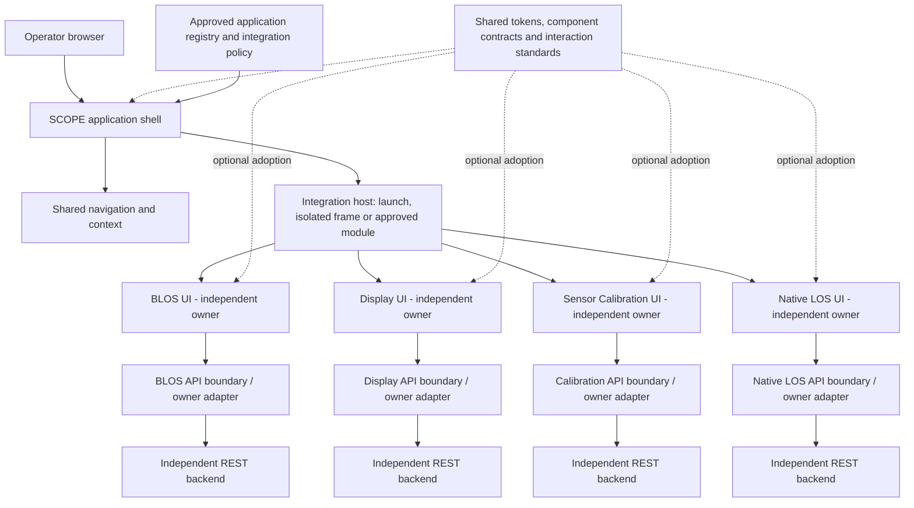

# SCOPE UI target architecture

Status: design exploration and architectural recommendation. No stackup internals, endpoint schemas, deployment platform or frontend framework have been supplied. This document describes the target shape, not a phased delivery plan.

## A. Purpose and scope

SCOPE gives operators a common browser entry point for independently developed BLOS, Display, Sensor Calibration and Native LOS applications. The shell makes applications discoverable and provides consistent navigation, context and feedback. Each application retains its functionality, backend, owner and release lifecycle. BLOS already exists; this effort neither redesigns it nor assumes it can be embedded.

The single-file [demonstrator](../mockups/scope-ui-concepts.html) explores presentation and local interactions. Its shared JavaScript and embedded CSS are packaging conveniences for offline review. Production need not share that runtime or form a monolith. The reserved `src/` directory contains no production application.

## B. Architecture drivers

| Driver | Architectural consequence |
| --- | --- |
| Independent technical ownership | No application-to-application imports, backend dependencies or shared mutable domain store |
| Common operator experience | Shell navigation, documented state semantics, shared tokens and integration acceptance contracts |
| Existing independently developed UIs | Support launch links and isolated embedded applications; do not mandate a rewrite |
| Dark room with blue ambient lighting | Restrained luminance, stable placement, textual abnormal-state cues and visible keyboard focus |
| Extended operation | Predictable feedback, progressive disclosure, explicit freshness and failure indicators |
| REST-accessible functionality | Owner-controlled API contracts with versioned adapters where normalization is needed |
| Unknown stackups and hosting topology | Configuration-driven registry with explicit capabilities and trust policies |
| Failure isolation | Shell remains usable when one UI or backend fails; no aggregate all-or-nothing startup |
| Security | Independently enforced backend authorization and deliberate browser trust boundaries |

Quality attributes to evaluate include availability, accessibility, change isolation, consistency, observability, latency and maintainability. No numerical service objectives have been supplied.

## C. Conceptual system architecture

The arrows express responsibility boundaries, not invented endpoint definitions. A launch integration may open a different browser page; an embedded integration occupies the shell's host region. A gateway or backend-for-frontend is optional for policy enforcement and narrow normalization; it must not become the owner of stackup business logic.

## D. Component responsibilities

| Component | Owns | Does not own |
| --- | --- | --- |
| SCOPE shell | Page frame, selected application, shell-level loading/failure, operator context and host lifecycle | Domain operations or stackup business rules |
| Navigation framework | Approved application list, stable ordering, deep-link coordination, availability explanations and focus restoration | Determining authorization from visual visibility alone |
| Shared UI components | Buttons, input patterns, disclosures, confirmations and accessible status presentation | Domain-specific workflows |
| Design system | Versioned semantic tokens, typography, spacing, states and operator interaction standards | A mandatory internal application framework |
| API adapters | Explicit contract translation, cancellation, error normalization and freshness metadata where justified | A universal speculative data model |
| Independent UI modules | Their routes, domain state, operations, validation and integration lifecycle implementation | Sibling applications' state or network clients |
| Stackup backends | Data and operation semantics, authorization, API contracts, version support and availability reporting | Shell appearance |

Shell alerts cover shell concerns. Application alerts remain owned by their application unless a supplied contract explicitly promotes selected events to a common notification area. Deduplication, severity mapping and acknowledgement ownership must then be specified.

## E. Decoupling strategy

- **Independent development:** each application publishes an integration contract and tested compatible versions. The shell consumes those contracts rather than private implementation details.
- **Backend ownership:** applications call their own REST boundaries; any shared gateway enforces policy without merging domain implementations.
- **Module isolation:** default to a separate browser document or separately hosted launch. Same-realm modules require explicit trust and lifecycle compatibility.
- **Shared contracts:** define application identity, approved entry location, integration mode, navigation intents, lifecycle and failure reporting. These are shell integration concerns, not guessed REST fields.
- **API versioning:** owners declare compatibility and deprecation policy. Adapters absorb supported variations; incompatible versions show a meaningful integration failure.
- **Application discovery:** an approved registry drives application names, order, entry location, required permissions and declared capabilities. Validate configuration against a versioned schema. Do not discover arbitrary URLs supplied by operators.
- **Failure isolation:** asynchronous independent initialization, per-application timeouts, bounded retries and cancellation. A failed app must not block application switching.
- **Change propagation:** design tokens and shared components use explicit versions. New versions require compatibility review, not silent global replacement. A common visual standard can be implemented by different frameworks.
- **State ownership:** keep shell selection and preferences separate from domain state. Cross-application communication uses narrow, versioned intents; do not build a shared global domain event bus.

For additions, an owner supplies an approved registry entry and demonstrates integration-contract compatibility. Existing applications should not need code changes. Whether registry changes require a shell deployment depends on configuration delivery policy, which remains open.

## F. UI integration options

| Option | Benefits | Security/runtime constraints | Deployment/maintenance tradeoffs | Fit |
| --- | --- | --- | --- | --- |
| Independently hosted launch | Highest lifecycle independence; existing UI can remain intact | Separate page context; secure entry allowlist and coordinated sign-in needed | Simplest deployment; shell frame and visual continuity may be lost | Baseline when embedding is unsupported |
| Cross-origin iframe | Browser document/CSS isolation; independently hosted UI; framework neutral | Embedding must be allowed by frame policy; sandbox, permissions, origin-checked messages and session behavior need agreement | Independent deployment; focus, sizing, routing, accessibility and nested scrolling need testing | Preferred embedded option when existing apps support it |
| Runtime micro-frontend composition | Seamless layout and navigation; independently owned modules possible | Same-realm code usually shares shell privileges; runtime dependency and CSS collisions | Runtime/version compatibility and rollback coordination add overhead | Trusted apps with a strong need for deep composition |
| Web Components | Framework-neutral element interface; optional Shadow DOM styling boundary | Shadow DOM is not a security sandbox; code still runs with document privileges | Attribute/event/lifecycle contracts need versioning; framework wrappers may be needed | Small trusted widgets and bounded shared UI surfaces |
| Shared application framework | Uniform component behavior and straightforward in-process composition | Shared runtime and release assumptions; one failure may affect the whole UI | High consistency but increased migration cost and lifecycle coupling | Optional for new cooperating modules, not a prerequisite |

Micro-frontends describe organizational/composition boundaries, not a single isolation technology; frames and Web Components can both be used within that approach. Separate hosting does not itself provide same-realm isolation when code is imported into the shell.

**Recommendation:** use a framework-neutral shell and approved registry supporting launch integration first as a capability, and isolated embedding when verified with the owner. Offer shared tokens and standards. Adopt same-realm modules or Web Components only where benefits outweigh the additional trust and runtime coordination. No evidence yet justifies mandating React, Vue, Angular or another application framework.

For iframes, assess `frame-ancestors` on the embedded application and `frame-src` on the shell, sandbox capabilities, permissions policy, authentication redirects and storage behavior. Sandbox settings must be selected for the actual origin and required capabilities; do not copy a permissive template. The [MDN iframe reference](https://developer.mozilla.org/en-US/docs/Web/HTML/Reference/Elements/iframe) describes the relevant controls and sandbox limitations.

## G. REST/API integration architecture

Application owners publish their API contracts and semantics, preferably in machine-readable form when available. SCOPE must not infer an API from rendered UI labels. No endpoint paths, payloads or sensor operations are specified here.

Configuration resolves approved environments and API locations independently of the visual concept. Browser-direct REST calls require the appropriate origin, credential and CORS policy. A gateway can simplify origin and session policy but adds an availability dependency and must remain narrowly scoped.

An adapter may normalize shell-relevant availability, generic error categories or timestamp formatting after actual contracts are supplied. Keep raw domain meaning, units and operation semantics with the owner. Do not equate a loaded UI with a healthy backend, or a successful network request with a completed domain operation.

Use bounded timeouts, cancellation on navigation, correlation identifiers and documented retry policies. Retry only operations whose contract makes retries safe; avoid duplicate mutations. Distinguish unauthenticated, unauthorized, unavailable, invalid input and incompatible integration. Preserve recoverable work and expose freshness where data is retained.

Authentication should follow the organization's chosen identity model. Shell and applications may share an identity provider without sharing raw tokens through browser messages. Backends independently enforce authorization on every protected operation. Cookie/session policies, CSRF protections for cookie-authenticated mutations, CORS and credential handling depend on deployment topology and must be agreed before integration. Session expiry must not silently resubmit a previously confirmed command.

## H. Common UI design system

Publish semantic tokens for surfaces, text, boundaries, accent, success, warning, error and information; typography, spacing, radius and focus. Components consume the semantic layer rather than arbitrary concept colors. The prototype's twelve palettes are alternatives, not twelve production themes to support simultaneously.

The shared component contract includes accessible names, default/hover/focus/pressed/selected/unselected/disabled states, loading and outcome feedback where applicable. Unselected remains actionable. Disabled is unavailable. Pressed is transient; selected persists. Status is expressed with text and symbols as well as color. Passive statuses do not acquire artificial pressed states.

Navigation positions remain stable. Explain unavailable applications rather than removing them unexpectedly. Modal confirmation states the action and context, uses conservative initial focus and restores focus. Scope shortcuts so embedded applications retain their own keyboard behavior. No repeated flashing or unnecessary autonomous motion.

Native HTML behavior is preferred for forms and disclosures. For custom tabs, implement tablist/tab/tabpanel relationships, a single tab stop, arrow keys and optional Home/End as described by the [WAI-ARIA tabs pattern](https://www.w3.org/WAI/ARIA/apg/patterns/tabs/). This prototype uses automatic activation on arrow navigation.

## I. Information and visualization models

Define the information before choosing a component. The full information inventory is in [Design Requirements](SCOPE-UI-Design-Requirements.md).

| WHAT: generic category | HOW: candidate representation | Reason and constraint |
| --- | --- | --- |
| Application identity and selection | Stable navigation label with selected marker | Makes current context explicit without prescribing domain content |
| Availability and connection state | Symbol + text badge and explanation panel | Separates availability from selection; unknown is not ready |
| Generic measurement | Value with unit; optional trend | Supports precise reading; a trend needs scales and time semantics |
| Historical value | Labeled line chart and text equivalent | Reveals change only when comparison over time is meaningful |
| Configuration and entered values | Labeled fields, draft/saved marker | Distinguishes unsaved edits from accepted state |
| Control availability | Enabled/disabled treatment with reason | Prevents misleading controls and clarifies constraints |
| Confirmation | Context-specific modal | Makes consequences reviewable before a consequential action |
| Alerts and errors | Severity symbol, text, recovery action | Supports rapid recognition independent of hue |
| Time and events | Explicit time basis and ordered history | Supports sequence and freshness reasoning |
| Context | Disclosure or keyboard-accessible tooltip | Keeps secondary prose available without constant clutter |

These categories are an abstract inventory, not requirements assigned to any named application. A gauge is not justified by aesthetics alone; use it only when range and thresholds are meaningful. The prototype's trend is explicitly a static reference, not a live measurement.

## J. Failure and degraded operation

The shell renders independently of application startup. Distinguish unconfigured, initializing, available, unavailable, unauthorized, stale and incompatible states when supported by real evidence. The prototype only illustrates available/unavailable and local control feedback.

If one application fails, retain its navigation identity, explain the state and allow switching. Offer retry only when it has defined behavior. A launch integration cannot guarantee in-shell health visibility without an owner-provided signal. Frame load events alone do not prove readiness; use a versioned handshake if the application supports one. A missing handshake becomes unknown or unavailable after the agreed timeout.

Discard late callbacks from inactive host instances. Release subscriptions and cancel requests on unmount. Preserve drafts only under an explicit data-handling policy. Retained data needs visible freshness and must not imply live operation. Shell-wide identity failure requires a consistent session message rather than unrelated per-app errors.

## K. Security considerations

Treat shell, application origins and backends as separate trust boundaries. Trust is granted through approved configuration, not through UI similarity. Validate launch targets and redirect destinations. Avoid shell tokens in URLs, logs or cross-window events.

For cross-origin messaging, send to a specific expected origin; validate sender origin, source window, message type, version and payload before acting. Never evaluate message content or allow arbitrary navigation/API calls. The [MDN postMessage reference](https://developer.mozilla.org/en-US/docs/Web/API/Window/postMessage) explains origin targeting and receiver validation. Messaging creates an intentional bridge across isolation and should remain minimal.

Frames require deliberate sandbox and browser feature permissions. Same-origin embedded content can have stronger access than an operator expects; separate origins may be needed for isolation. Web Components provide composition and style scoping, not a hostile-code security boundary. Same-realm micro-frontends are trusted code and require dependency governance.

Use HTTPS, backend input validation and authorization, appropriate content security policy, secure cookie policy, session expiry handling and minimal sensitive telemetry. The architecture does not establish safety classification or approve operational command semantics. Those require supplied stackup requirements.

## L. Architectural decisions and tradeoffs

| Decision | Alternative | Rationale / consequence |
| --- | --- | --- |
| Shell with owner-controlled integrations | Rewrite all UIs into one app | Preserves existing BLOS and release independence; visual uniformity will be incremental by agreement |
| Multiple registry-driven integration modes | Require runtime module composition | Supports unknown existing UIs; host must explain mode-specific navigation and failures |
| Isolation before deep composition | Same-realm integration everywhere | Reduces privilege and failure coupling; embedded focus/session behavior needs validation |
| Shared semantic contracts | Shared framework mandatory | Allows independent implementations; conformance needs review and acceptance checks |
| Owner APIs and bounded adapters | Universal SCOPE domain API | Avoids invented abstractions; multiple contracts remain visible to integration owners |
| Explicit availability and unknown states | Hide unavailable applications | Preserves operator orientation; explanations require space |
| Qualitative style exploration | Select a winner from aesthetic scores | Avoids unsupported usability conclusions; operator evidence is still required |

## M. Open questions and assumptions

- What hosting origins, embedding policies, routes and supported browsers do the four applications provide?
- Does BLOS permit frames, supply lifecycle messages or prefer launch-only integration?
- What identity provider, role model, session policy and network boundaries apply?
- Which API versions, contracts, health evidence and error taxonomies are available?
- Which system-level alerts, if any, need aggregation and who owns acknowledgement?
- What display resolution, physical viewing distance, luminance, ambient lighting and pointer hardware define the console?
- Is simultaneous multi-application viewing needed, and how should navigation preserve unsaved domain work?
- What security, audit, availability and operational assurance requirements apply?
- Who owns registry approval, design-system governance, compatibility testing and rollback?

Assumptions are limited to browser access, independently developed interfaces and REST backends as supplied by the owner. Generic UI examples are not evidence of actual stackup capabilities. Final architecture and visual selection remain subject to these answers and operator evaluation.
